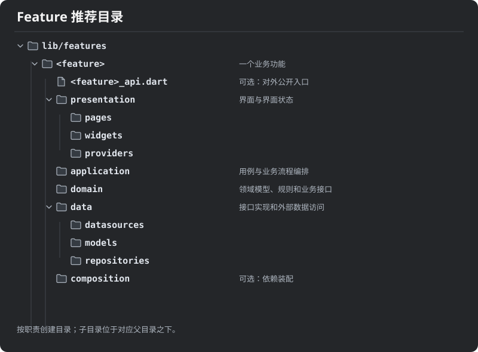
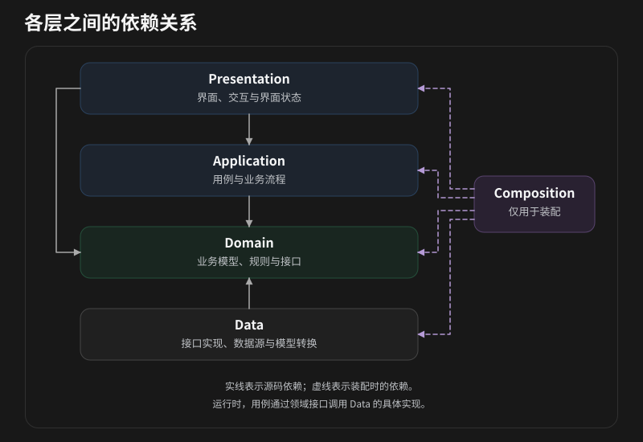

# Feature First + Clean Architecture 架构规范

本文定义 `lib/features/` 目标架构。

## 核心原则

- **Feature First**：先按业务能力划分功能模块，再在模块内部按职责分层。一个 feature 表达相对独立的业务能力，可以包含多个页面、入口和用例；页面不等同于 feature。
- **Clean Architecture**：业务规则位于内层，技术实现位于外层。源码依赖始终指向更稳定的内层，内层不依赖外层的类型或实现。
- **依赖倒置**：用例需要外部能力时，由内层定义面向业务的接口，外层实现接口，最后在装配位置注入实现。
- **按需组织**：目录代表职责，不要求为不存在的职责创建空目录，也不要求每个类都配套一个抽象接口。省略某一层不代表可以跨越依赖边界。

## 推荐目录

这是职责模板，不是必须完整创建的目录树。`data/` 是外部数据和平台能力的适配层；若项目将同一职责命名为 `infrastructure/`，迁移期间应保持该模块内部一致，边界要求相同。文件按业务概念与职责命名，不按技术类型机械拆分；生成文件与其源文件遵循项目的生成工具约定。

## 分层职责

### Domain：业务语言与规则

Domain 定义领域模型、值对象、业务规则及用例所需的仓储或外部能力接口。模型表达业务含义和不变量，接口使用业务类型描述输入、输出和失败语义。

Domain 不依赖 Flutter 界面、状态管理框架、Application、Data、网络响应、数据库对象或平台插件。业务规则应能脱离界面和具体存储实现进行测试。只有当外部能力确实需要由内层使用时才定义接口，避免为纯内部实现制造无意义的抽象。

### Application：用例与流程

Application 表达系统提供的操作：接收输入，调用领域规则和接口，编排事务顺序、并发或取消策略，并返回可供调用方处理的结果。用例可以是类或函数，命名应反映业务意图。

Application 可以依赖 Domain 和同层必要的抽象，不依赖 Widget、页面状态、具体仓储、数据库、HTTP 客户端或平台插件。界面生命周期和展示格式留在 Presentation；协议细节与数据转换留在 Data。简单查询也应通过用例或明确的应用查询接口进入内层，不直接从界面访问具体数据源。

### Presentation：交互与展示

Presentation 包含页面、组件、路由入口以及面向界面的状态管理。它将用户操作转换为用例调用，将结果映射为加载、内容、空状态和错误等界面状态，并管理界面相关的订阅与释放。

Presentation 可以使用 Application 的公开用例和 Domain 的业务类型，但不直接依赖 Data 的具体实现或访问网络、数据库和平台插件。状态管理工具是界面适配手段，不应承载需要脱离界面复用或验证的业务规则。界面状态、格式化和导航决策留在本层。

### Data：外部能力适配

Data 实现 Domain 定义的仓储和能力接口，负责访问远端、本地存储或平台服务，将外部数据模型转换为领域模型，并将技术错误转换为接口约定的失败语义。数据源处理协议和持久化细节；仓储实现组合数据源并履行业务接口契约。

Data 可以依赖 Domain 和外部库，不反向依赖 Presentation 或 Application 的具体实现。DTO、数据库实体、响应对象及插件类型不穿透到 Domain 和用例的公开接口。缓存等实现策略可以放在 Data；影响业务结果的规则应由 Domain 或 Application 明确拥有。

### Composition：依赖装配

装配代码选择具体实现，将 Data 实现绑定到 Domain 接口，并构造 Application 用例和 Presentation 所需依赖。装配可以位于 feature 的 `composition/`，也可以由应用级组合根负责跨模块和全局依赖。装配代码允许同时引用各层，但只负责创建、绑定及生命周期管理，不承载业务规则。

## 依赖规则

箭头表示源码依赖，而非运行时调用方向：

运行时，用例通过 Domain 接口调用 Data 实现；这不会改变源码依赖方向。Domain 不依赖其他层；Application 不依赖 Presentation 或 Data；Data 不依赖 Presentation 或 Application；Presentation 不直接依赖 Data。依赖规则同样适用于间接的 `import`、`export` 和公开接口中的类型，不能通过转发文件绕过。

## Feature 边界与共享

一个 feature 拥有其业务规则、用例和实现。其他 feature 需要使用其能力时，通过该 feature 明确维护的公开入口访问稳定的应用能力或业务契约，不导入其内部页面、状态管理或数据实现。公开入口应尽量小，避免导出整个目录；跨 feature 依赖不得形成环。

仅被一个 feature 使用的代码留在该 feature。确实被多个 feature 使用且语义稳定的通用技术能力，可放到项目的共享基础设施；跨业务共享的领域概念应有清晰的归属和依赖方向，不能为了消除少量重复而把业务规则放进通用工具目录。应用级装配负责连接不同 feature，不让它们通过彼此的内部实现耦合。

## 开发与评审流程

1. 确定业务能力及其所属 feature，明确输入、输出和业务规则。
2. 在 Domain 定义必要的模型、规则和外部能力契约；在 Application 实现用例及流程。
3. 在 Data 实现契约并处理外部数据转换；在 Presentation 接入用例并呈现状态。
4. 在组合根绑定实现，明确对象及订阅的生命周期；仅暴露其他 feature 确实需要的公开能力。
5. 检查直接和间接依赖、错误边界及跨 feature 耦合，并按风险验证行为。

测试应覆盖有意义的业务规则和流程：Domain 测试不依赖外部服务；Application 测试通过替身验证流程及失败分支；Data 测试验证映射和适配契约；Presentation 测试验证关键交互与状态。按改动范围选择测试，必要时增加跨层集成测试。提交前运行项目适用的静态分析、架构检查及受影响功能测试；现有自动检查的覆盖范围不能替代对本规范的评审。
